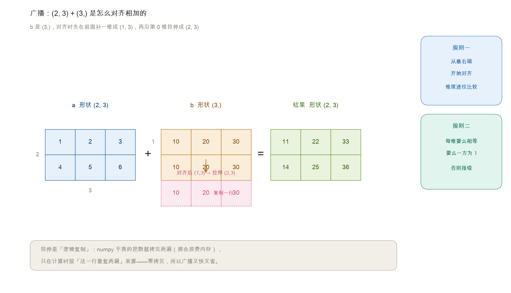
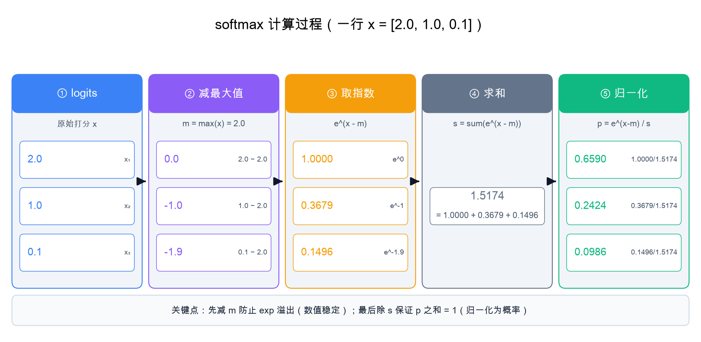
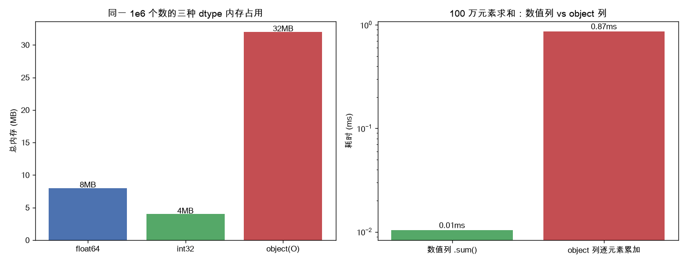
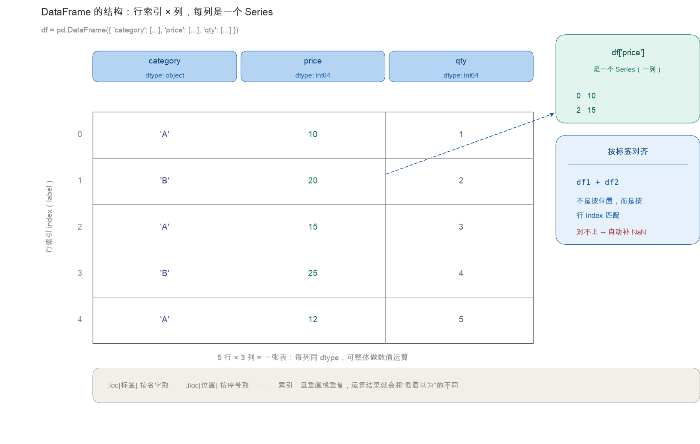
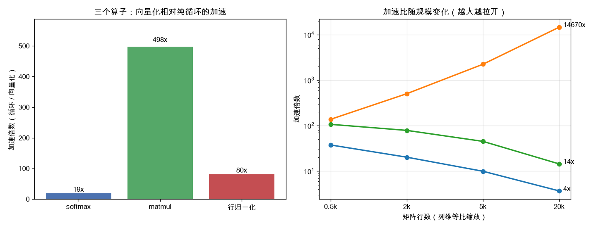
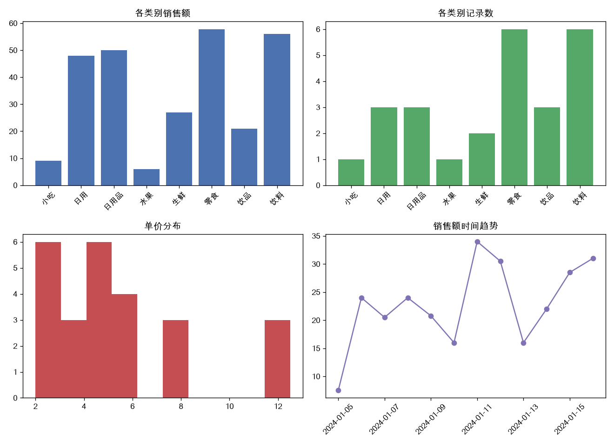
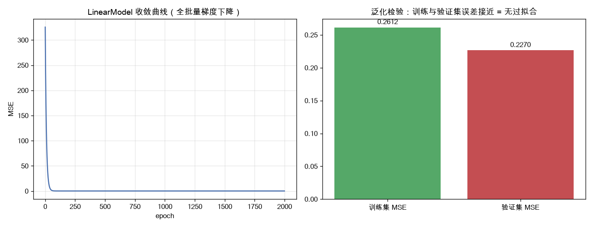

# 第 1 章 Python 科学计算基础

> 本章定位：面向**已有 Python 基础**的读者，聚焦大模型学习真正用得上的科学计算三件套——**numpy（数值计算）、pandas（数据处理）、matplotlib（可视化）**，以及用**面向对象**组织机器学习流水线的习惯。
>
> 本章不重复"变量、循环"这类语法入门，但**每个概念都会先给一句通俗讲解**，再上代码。如果你对某个库已经很熟，可以跳读；如果感觉"为什么是这样"，本节就是写给你看的。

---

## 1.1 本章学习目标

读完本章，你应当能够：

1. 用 **numpy 向量化**重写循环计算，理解广播（broadcasting）机制，并说清它**为什么**更快；
2. 读懂 **dtype 与内存布局**，解释"一个脏字符串为什么能毁掉整列"；
3. 用 **pandas** 完成真实表格数据的读取、清洗（缺失值 / 重复值 / 脏字符）、索引筛选、分组聚合与合并；
4. 用 **matplotlib** 绘制折线 / 柱状 / 散点图与多子图，并正确配置中文显示；
5. 用**类与继承**封装 `Dataset` / `Model` 等抽象，写出可复用的训练代码骨架，并避开数据泄漏。

---

## 1.2 为什么大模型学习离不开这三件套

大模型本质上是"在大规模张量上做矩阵运算"。无论你是用 PyTorch 训练模型，还是用 numpy 手写一个 softmax，底层思维都是一样的：**把数据看成数组，把计算看成向量化操作**。

一个帮助理解的比喻：把数据想象成**一摞整齐的表格**，普通 Python 像"拿笔一行行手写计算"，而 numpy 像"把整摞表格塞进一台复印机，一键批量处理"。这三件套各自的角色：

- **numpy** 提供 N 维数组与底层数值运算，是几乎所有 ML 库的基石——你可以把它当作"复印机"本身；
- **pandas** 让你以"表格"方式清洗、探查训练语料与实验结果——它是给"复印机"喂料的"表格整理台"；
- **matplotlib** 让你把 loss 曲线、注意力权重、评测分数画出来——**看图比看数字快得多**，它是"结果展示屏"。

本章所有代码示例都力求可直接运行（配套仓库 `ch01/` 含完整脚本）。建议边读边敲。

---

## 1.3 numpy：向量化计算的核心

### 1.3.1 ndarray 与基本操作

**什么是 ndarray？** `ndarray`（N-dimensional array，N 维数组）是 numpy 的核心数据结构。把它想象成一个**整齐的、同种类型数据的盒子阵列**——所有盒子在内存里首尾相接排成一排（连续存储），而不是像 Python 列表那样一个个分散存放。因为"整齐 + 同类型"，numpy 可以直接调用编译后的 C/Fortran 内核一次性算完，而不必逐个解释执行。这就是它快的根本原因。

```python
import numpy as np

a = np.array([[1, 2, 3],
              [4, 5, 6]])      # 形状 (2, 3)：2 行 3 列
print(a.shape)                 # (2, 3)  —— 每个维度上有几个元素
print(a.ndim)                  # 2       —— 几维
print(a.dtype)                 # int64   —— 盒子里装的是什么类型
```

**三个常用属性的直觉**：

- `shape`：元组，告诉你"每一维有几个元素"。`(2, 3)` 就是 2 行 3 列。
- `ndim`：数组的"维数"，等于 `len(shape)`。
- `dtype`：数据类型。`int64` / `float64` 最常见；numpy 要求同一数组里所有元素类型一致。

```python
# 常用构造器
zeros = np.zeros((3, 4))       # 全 0，形状 (3, 4)
ones  = np.ones((2, 2))        # 全 1
rng   = np.arange(10)          # 0,1,...,9  （类似 Python 的 range，但返回数组）
lin   = np.linspace(0, 1, 5)   # 等距 5 个数：[0, 0.25, 0.5, 0.75, 1]
```

> **`arange` 与 `linspace` 的区别**：`arange` 管"步长"（从起点按固定间隔数数），`linspace` 管"个数"（把区间均匀切成 n 份）。要整数序列用 `arange`，要均匀采样用 `linspace`。

```python
# 数学运算默认是逐元素的（element-wise）
print(a * 2)                   # 每个元素乘 2
print(a.sum(axis=0))           # 按列求和：[5 7 9]
print(a.mean(axis=1))          # 按行求平均
```

**`axis` 参数的直觉**（初学者最易混）：`axis=0` 表示"沿着**第 0 维（行）的方向**去聚合"，也就是把不同的行压扁合并，结果保留列。所以 `sum(axis=0)` 跨行相加 → 得到每列的和 `[5,7,9]`。反之 `axis=1` 是跨列相加 → 得到每行的和。一句话记忆：**`axis=k` 就是"抹掉第 k 维"**。

```python
x = np.array([[1, 2], [3, 4]])
y = np.array([[5, 6], [7, 8]])
print(x @ y)                   # 矩阵乘法
print(np.dot(x, y))            # 等价写法
```

> **要点**：numpy 的 `+ - * /` **默认是逐元素运算，不是矩阵乘法**。矩阵乘法必须用 `@` 或 `np.dot`。这一点在大模型里至关重要——注意力分数和向量的相乘全靠 `@`。

---

### 1.3.2 广播机制（Broadcasting）

> **为什么需要广播？** 现实中你常想"让一个 (2,3) 的矩阵每一行都加上同一个长度为 3 的向量"。如果每次都手写循环、手动把向量复制成 (2,3)，既慢又啰嗦。广播就是 numpy 替你做的**自动对齐 + 隐式复制**。

**广播规则（记住两条即可）**：

1. 从**最右边**的维度开始对齐比较；
2. 两个数组在某个维度上大小**相等**，或其中一方为 **1**，就能对齐；否则报错。

```python
a = np.array([[1, 2, 3],       # 形状 (2, 3)
              [4, 5, 6]])
b = np.array([10, 20, 30])     # 形状 (3,)

print(a + b)
# 对齐过程：a 是 (2,3)，b 是 (3,) → 先给 b 前面补一维变成 (1,3)
#          再沿第 0 维"拉伸"成 (2,3)：[[10,20,30],[10,20,30]]
#          然后逐元素相加
# 结果：
# [[11, 22, 33],
#  [14, 25, 36]]
```

> **如何理解"拉伸"**：广播并不会真的复制数据（那样浪费内存），而是告诉底层"这个短向量在逻辑上要重复铺满整行"。你写代码时当它在复制就行，但 numpy 内部是零拷贝的高效实现。



```python
# 经典用法：对每个样本减去均值、除以标准差（标准化 / Standardization）
data = np.array([[1.0, 2.0, 3.0],
                 [4.0, 5.0, 6.0],
                 [7.0, 8.0, 9.0]])
mean = data.mean(axis=0)       # 每列均值，形状 (3,)
std  = data.std(axis=0)        # 每列标准差
norm = (data - mean) / std     # (3,3) 减 (3,) 触发广播，再除以 (3,)
print(norm)
```

> **为什么标准化这么常用？** 不同特征尺度差异大（比如"年龄"是 0~100、"收入"是 0~100000），直接喂给模型会让梯度忽大忽小、训练不稳。减均值除标准差把每个特征都拉到"均值 0、标准差 1"的标准尺度，训练更稳——第 1.6 与第 3 章会反复用到。

---

### 1.3.3 向量化 vs 循环：为什么快

**向量化（vectorization）** 指"把对整个数组的运算写成一条指令，而不是用 `for` 循环逐个元素算"。Python 的 `for` 循环每次迭代都要走一遍解释器，开销大；numpy 把运算整体下沉到编译后的内核，一次处理整块内存。

下面用 **softmax** 对比两种写法。先说 softmax 是什么：

**softmax 的直觉**：它把一组任意实数（比如模型的原始打分 logits）变成一组**和为 1 的正数**，可以理解为"概率分布"。公式：对每个元素 `x_i`，先取指数 `e^x_i`（把负数也变成正、并放大差异），再除以所有元素指数之和，确保总和归一为 1。

```python
import numpy as np

def softmax_loop(x):
    """纯循环实现的 softmax（仅作对比，不要在生产用）。"""
    out = np.zeros_like(x)
    for i in range(x.shape[0]):
        m = x[i].max()
        s = 0.0
        for j in range(x.shape[1]):
            s += np.exp(x[i, j] - m)
        for j in range(x.shape[1]):
            out[i, j] = np.exp(x[i, j] - m) / s
    return out

def softmax_vec(x):
    """向量化实现：减去最大值保证数值稳定。"""
    m = np.max(x, axis=1, keepdims=True)
    e = np.exp(x - m)
    return e / np.sum(e, axis=1, keepdims=True)

x = np.random.randn(2000, 50)
%timeit softmax_loop(x)        # 约数十毫秒（需在 Jupyter 中运行）
%timeit softmax_vec(x)         # 约数百微秒，快 100 倍以上
```

> **两段代码的关键差异**：
>
> - `keepdims=True` 让 `max`/`sum` 的结果保持维度（如 `(2000,1)` 而非 `(2000,)`），这样 `@`/除法能正确触发**广播**对齐，否则会报错或算错。
> - 向量化版没有任何 `for`，一条表达式搞定整批数据。

下面用一行具体数字走一遍 softmax 的五个步骤，把上面那两行代码"拆开看"：



> **数值稳定小技巧（重要）**：`softmax` 里先减去每行最大值 `m`，数学上结果**不变**（分子分母同乘 `e^{-m}` 抵消），却能避免 `exp(大数)` 溢出成 `inf`。这是大模型里随处可见的写法——分类头、注意力权重都用它。

除了 softmax，还有一个常见的向量化操作：**行 L2 归一化（row L2 normalization）**。它把矩阵的**每一行**都变成"长度为 1 的向量"——用该行自身的 L2 范数（欧几里得长度，`sqrt(x_1^2 + x_2^2 + ... )`）去除整行。归一化后行内各分量的相对比例不变，只是模长被拉成 1，常用于"只关心方向、不关心大小"的场景（比如余弦相似度、特征缩放）。

```python
M = np.random.randn(3, 4)
# 向量化：先求每行的 L2 范数（keepdims 保持 (3,1) 才能广播对齐），再整行去除
M_norm = M / np.linalg.norm(M, axis=1, keepdims=True)
print(np.linalg.norm(M_norm, axis=1))   # [1. 1. 1.]，每行模长都为 1
```

---

### 1.3.4 dtype 与内存布局：一个脏字符串为什么能毁掉整列

前面说 numpy 快的原因是"整齐 + 同类型"，但**"同类型"到底带来什么**？本节用一段 30 行代码把答案量化出来——它会改变你清洗数据时的优先级。

```python
import numpy as np, sys

vals = np.random.default_rng(0).normal(10, 3, size=1_000_000)

# 三种 dtype 装同一批数
f64  = vals.astype(np.float64)      # 8 字节/个
i32  = vals.astype(np.int32)        # 4 字节/个
obj  = np.empty(len(vals), dtype=object); obj[:] = vals   # 每个格子是一个独立 Python 对象

# 能否聚合？
f64.mean()      # 0.10 ms，一次 C 内核扫完
obj.mean()      # TypeError: unsupported operand —— object 列根本不能 .mean()

# 内存真相：object 列 = 指针数组 + 每个独立对象
print(f64.nbytes / 1e6)              # 8.0 MB
print(i32.nbytes / 1e6)              # 4.0 MB
print((obj.nbytes + len(obj) * sys.getsizeof(1.0)) / 1e6)   # ≈ 32.0 MB
```

> **为什么"一个脏字符串"能毁掉整列？**（反例：整列退化为文本） 因为 pandas 读 CSV 时要为每列挑一个统一的 dtype。只要列里出现一个转不成数字的值（比如 `"6.0元"`），整列就只能退化成文本 `object`。后果是**连锁的**：这一列从此参与不了数值运算，`mean()` 会直接抛 `TypeError`；更糟的是报错点常常离病根很远——你可能在第 3 章做标准化时才撞上异常，却完全想不到源头是这里混进去的一个"元"字。所以清洗的第一个动作永远是先看 `dtype`，而不是急着写计算。

> **object 列有多贵？**（类比：把一箱硬币拆成一个个信封） `float64` 列是"一箱整齐的硬币"，8 字节一个、连续排布；`object` 列则是"把每枚硬币单独装进一个信封再塞进纸箱"——每个格子只是一个 8 字节的指针，真正的数在堆里分散存放，每个 Python `float` 对象还要额外占 24 字节。实测同样 100 万个数：`float64` 占 8 MB，`object` 列占 **32 MB（4 倍）**。

> **向量化为什么快？（反例：逐元素累加慢 83 倍）** 不只是"没有 Python 循环开销"这么简单，更根本的是**内存局部性**：`float64` 列的数据连续排布，CPU 缓存（cache）可以整块预取、SIMD 指令一次处理 8 个；`object` 列的每个对象在堆里东一个西一个，CPU 每取一个数都可能缓存未命中。实测对 100 万元素求和：数值列 `.sum()` 用 0.010 ms，`object` 列逐元素累加用 0.86 ms，**慢 83 倍**——这正是"向量化优先"在内存层面的根因。

完整演示见 `ch01/project1b_dtype_demo.py`，产物 `ch01/dtype_demo.png`。



---

### 1.3.5 常用函数速查与线性代数预热

下面是一张"够用到第 7 章"的函数速查表，先混个眼熟，用到时回来查。

| 类别   | 函数                                            | 说明                        |
| ---- | --------------------------------------------- | ------------------------- |
| 聚合   | `sum / mean / std / max / argmax`             | 可指定 `axis`（回忆：axis 抹掉那一维） |
| 线性代数 | `np.dot / @ / np.linalg.norm / np.linalg.svd` | 矩阵乘、范数、奇异值分解              |
| 随机   | `np.random.randn / default_rng`               | 高斯采样、可复现随机                |
| 形状   | `reshape / transpose / concatenate / stack`   | 改变与拼接张量                   |

```python
# 用 SVD 做一次降维（为第 2 章 PCA 预热）
X = np.random.randn(100, 5)
U, S, Vt = np.linalg.svd(X, full_matrices=False)
X_reduced = U[:, :2] @ np.diag(S[:2])   # 取前 2 个主成分
```

> **SVD 是什么（一句话）**：奇异值分解（Singular Value Decomposition）把任意矩阵拆成"左旋转 × 缩放 × 右旋转"三个矩阵。缩放因子 `S` 里大的分量代表"重要信息"，砍掉小的就能压缩/降维。这是 PCA、推荐系统、甚至大模型低秩压缩（如 LoRA）的数学根基，先知道它存在即可。

---

## 1.4 pandas：结构化数据处理

真实世界的训练数据几乎都是表格：销售记录、标注样本、实验日志。**pandas 让你用"列式"思维高效处理它们**——不是"一行行读"，而是"按列整体操作"。

### 1.4.1 Series 与 DataFrame

**两个核心容器**：

- `Series`：带索引（行标签）的**一维**数组，类比"表格里的一列"。
- `DataFrame`：由多个 `Series` 横向拼成的**二维表格**，所有列共享同一套行索引——这才是你日常说的"一张表"。

```python
import pandas as pd

s = pd.Series([10, 20, 30], index=['a', 'b', 'c'])
# 一列三行，行标签分别是 a/b/c

df = pd.DataFrame({
    'category': ['A', 'B', 'A', 'B', 'A'],
    'price':    [10, 20, 15, 25, 12],
    'qty':      [1, 2, 3, 4, 5],
})
print(df.head())               # 默认看前 5 行
print(df['price'].mean())      # 取 price 这一列，求均值
print(df.describe())           # 数值列的统计概览（计数/均值/最值/分位数）
```



> **`df['price']` 取出的是一个 Series**，`mean()` 是 Series 的方法。`.describe()` 会一次性给出数量、均值、标准差、最小/最大、四分位数——快速体检一张表非常方便。

> **为什么 pandas 要费劲引入"行索引"？**（类比：按名牌点名） 因为它让两个对象可以**按标签自动对齐**：`df1 + df2` 不是按位置一一相加，而是按行标签匹配，标签对不上的地方自动补 `NaN`。这在按时间戳对齐多份实验记录、多表合并时省事得多；但它同时是新手最容易"看不出哪里错了"的地方——一旦索引被重置或出现重复标签，运算结果就会和你"看着以为"的不一样。取值方式务必分清：`.loc[标签]` 按名字取，`.iloc[位置]` 按序号取。

---

### 1.4.2 读取与查看

配套仓库里的 `store_sales_dirty.csv` 是一份**刻意制造了多种脏点**的销售流水，我们用它来练手。先把它读进来"体检"——这正是数据科学的第一步：在动手清洗前，先看清表长什么样、每列是什么类型、哪里有缺失。

```python
# 读取配套仓库中的真实"脏数据"练习
df = pd.read_csv('store_sales_dirty.csv')
print(df.columns.tolist())
# ['订单日期', '商品名称', '类别', '数量', '单价(元)', '门店']
print(df.shape)               # (29, 6)
print(df.dtypes)              # 每列类型：注意 单价(元) 是 str，不是 float
print(df.isnull().sum())      # 各列缺失值数量
```

> **这份数据的"脏点"清单**（先眼熟，后面逐条处理）：
>
> - `单价(元)` 列混入了字符串 `"6.0元"` 和空值 → pandas 把整列读成**文本（str）**而非数字；
> - `类别`、`门店` 某些单元格首尾带空格（如 `" 小吃 "`、`" 海淀店 "`）；
> - `数量` 出现负值 `-2`（明显是录入错误）；
> - 整行重复（第 1 行与第 20 行、第 25 行与第 29 行完全一样）。
>
> 这些脏点的精确行号与 dtype 诊断，`ch01/project2_clean.py` 会自动打印（见 1.7 项目二）。

> **三个查看函数的读法**：
>
> - `shape`：表有多大的第一印象。
> - `dtypes`：看每列是什么类型（`int`/`float`/`str`）——**清洗前先确认这一列到底能不能当数字用**。
> - `isnull().sum()`：`isnull()` 把每个格子变成"是否为空"的 True/False，`sum()` 按列数 True 的个数 → 直接得到每列缺失几条。这是清洗前的必做体检。

---

### 1.4.3 索引与筛选

取数和筛选是 pandas 最高频的操作，也是 `.loc` / `.iloc` 最容易混的地方。

**先分清两个工具**：

- `.loc[...]`：**按标签**取（label-based）。`df.loc['a']` 取标签为 `a` 的那一行。
- `.iloc[...]`：**按位置**取（integer-based）。`df.iloc[0]` 取第 0 行（无论标签是什么）。

```python
df = pd.DataFrame({'a': [1, 2, 3], 'b': [10, 20, 30]},
                  index=['x', 'y', 'z'])
print(df.loc['y'])            # 标签 'y' 那行 → a=2, b=20
print(df.iloc[0])             # 第 0 行      → a=1, b=10
print(df.loc[1:, 'b'])        # 位置 1 起的所有行、b 列
```

**筛选：用布尔索引**——先造一个"哪几行满足条件"的布尔数组，再用它取行：

```python
sales = pd.DataFrame({
    '门店': ['朝阳', '海淀', '西城', '朝阳'],
    '金额': [120, 80, 200, 150],
})
big   = sales[sales['金额'] > 100]                 # 金额>100 的行
multi = sales[(sales['门店'] == '朝阳') & (sales['金额'] > 100)]
print(multi)
```

> **为什么布尔筛选能这么快？** 它不是"逐行判断再拼接"，而是把整列布尔条件一次性算成一个 0/1 掩码，再按掩码**向量化**地取出对应行——底层仍是 C 层的批量操作，和第 1.3 节的向量化是同一个道理。

> **筛选最常见的坑**（反例：条件之间用错 `and`） 很多新手写成 `sales[sales['金额'] > 100 and sales['门店'] == '朝阳']`——Python 的 `and` 会先去求 `sales['金额'] > 100` 这个**整列布尔数组**的真值，立刻抛 `ValueError: The truth value of a Series is ambiguous`。多条件要用 **`&`（与）/ `|`（或）**，且**每个条件单独加括号**：`(cond1) & (cond2)`。

---

### 1.4.4 分组聚合 groupby

**分组聚合是 pandas 最常用、也最像 SQL 的操作**。它的内部逻辑可以分成三步（记住这个"三明治"模型就不慌了）：

1. **Split（拆）**：按某个键（如 `category`）把表切成若干小表；
2. **Apply（算）**：对每个小表独立做计算（求均值、求和等）；
3. **Combine（合）**：把结果拼回一张新表。

```python
agg = (df
       .groupby('category')                  # 根据category做分类，执行三个聚合分析
       .agg(price_mean=('price', 'mean'),    # 新列名 = (原列, 聚合函数)
            qty_sum=('qty', 'sum'),
            n=('price', 'size')))            # size = 该组行数
print(agg)
```

> **命名聚合语法 `price_mean=('price', 'mean')`**：左边是"新列名"，右边括号里是"对哪一列用哪个函数"。这是 pandas 较新的写法，比老式 `groupby(...).mean()` 更可控，能在一行里混入不同的聚合方式。

> **为什么不自己写循环分组？**（反例：手写字典循环） 因为 `groupby` 把"拆-算-合"三步都放进了 C 层：它先一次性建好"组号 → 行位置"的映射，再对每组批量调用聚合函数，不在 Python 层逐行穿梭。但比速度更要紧的是**语义**：`groupby` 明确表达"按这个键的取值分区"，读代码的人一眼看懂你的意图；而手写循环通常还得额外维护一个字典，既慢，又容易漏掉"某个组一行都没有"这类边界情况。

> **分组前先 strip，否则"幽灵类别"会骗过你**（反例：` 小吃 ` 与 `小吃` 被算成两组） 若 `类别` 列的某些单元格带首尾空格，`groupby` 会把 `" 小吃 "` 和 `小吃` 当成**两个不同的组**，聚合结果凭空多出"幽灵类别"，每个组的统计都被稀释。本例 `store_sales_dirty.csv` 里就有这种脏点（第 4 行）。所以**任何按文本键分组之前，先 `str.strip()`** 是铁律——这也是为什么 1.7 项目二把"去空格"放在聚合之前。

---

### 1.4.5 缺失值与异常清洗

真实数据一定有缺失和脏值，清洗就是"决定怎么处理它们"。

```python
# 方式一：填充（fillna）—— 用某个代表值替掉空值
df['price'] = df['price'].fillna(df['price'].mean())   # 数值列常用均值

# 方式二：删除（dropna）—— 直接扔掉含空的行（缺失比例低时可行）
df = df.dropna(subset=['category'])

# 去重
df = df.drop_duplicates()

# 异常值裁剪（例如价格超过 3 倍标准差视为异常）
upper = df['price'].mean() + 3 * df['price'].std()
df = df[df['price'] <= upper]
```

> **为什么填均值 / 众数？**
>
> - 数值列填**均值**：保持该列整体平均值不变，是一种"最小扰动"的补全。
> - 类别列填**众数**（出现最多的值）：避免引入表里本来没有的类别。
> - **3σ 法则**：若数据近似正态分布，超出"均值 ± 3 倍标准差"的概率不到 0.3%，几乎可以肯定是录入错误或极端异常，故裁剪掉。注意：非正态数据别硬套，可改用分位数（如 1%/99% 截断）。

> **填充不是免费的——三种错法要避开**（反例：无脑填 0）：
>
> 1. **无脑填 0**：若某列是"价格""身高"这类量，填 0 等于凭空造出一批极端样本，会把均值硬拉下来。0 只有在"这个值本身有物理意义"时才可用（如"补充剂用量 = 0"确实表示没用）。
> 2. **用全表统计量填充**：`mean()` / `std()` 应当**只用训练集**算出来，再套用到验证集、测试集。若图省事在整张表上算，就把测试集的信息泄漏进了训练——这叫**数据泄漏**，第 1.6 与第 21 章会反复强调它的危害。
> 3. **忽略"缺失本身有意义"**：有些缺失并非随机（比如"未填写收入"的人往往收入偏高），此时更稳的做法是**额外加一列 `is_missing` 布尔标记**，把"缺失"这件事本身当成一个特征交给模型。

---

### 1.4.6 合并 merge

多个表按"键"拼起来，是特征工程的基本功。

```python
meta = pd.DataFrame({
    'category': ['A', 'B'],
    'desc': ['食品', '日用品'],
})
merged = pd.merge(df, meta, on='category', how='left')
print(merged.head())
```

> **`how` 的四种连接方式**（用集合比喻，谁保留谁）：
>
> - `inner`（内连接）：只保留两表**都有的** `category`（交集）；
> - `left`（左连接）：保留左表全部，右表缺的补 `NaN`（最常用）；
> - `right`（右连接）：保留右表全部；
> - `outer`（外连接）：两表所有的都保留（并集）。
>
> 本例用 `left`，保证销售明细一条不丢，只是补上类别描述。

> **工程提醒**：清洗逻辑一定要**可复现**——把处理步骤写成函数并记录参数，这对后续第 21 章"实验工作流"的复现要求至关重要。

---

### 1.4.7 时间序列处理

销售流水、实验日志几乎都带日期列。pandas 的 `DatetimeIndex` 让"按时间分组 / 重采样"变成一行代码。

```python
# 先把订单日期转成时间类型，再以订单日期为时间索引，按自然周分组，计算每周的销售额总和
df['订单日期'] = pd.to_datetime(df['订单日期'])
# 按周聚合销售额（W = 周，M = 月，D = 天）
weekly = (df.set_index('订单日期')
              .resample('W')['销售额']
              .sum())
print(weekly)
```

> **`resample` 的直觉**（类比：把流水账按月装订） 它把时间轴切成等宽的"桶"（周/月/季），再把每桶里的值按你指定的函数（求和、均值、计数）压成一个数。做"销售额随时间的趋势"图时，原始按天的点往往太密太碎，`resample('W')` 先压成周粒度，曲线立刻平滑可读——1.7 项目三的看板图就用了它。

> **时间列最常见的坑**（反例：日期被读成字符串） `pd.read_csv` 默认把日期列读成**字符串**，此时 `resample` 会直接报错。所以第一步永远是 `pd.to_datetime(...)` 显式转成时间类型。另一个坑：`resample` 的桶**从时间轴起点按规则切**，若你的数据不是从周一/月初开始，第一桶和最后一桶可能不满——读趋势图时要意识到这点，别把半个月的桶当成完整一周。

---

## 1.5 matplotlib：把结果画出来

"能画图就不要只看数字"。本章给出最常用、也最容易被踩坑（中文乱码）的画法。

### 1.5.1 基础绘图与中文配置

```python
import matplotlib.pyplot as plt
import numpy as np

# 解决中文乱码：matplotlib 默认字体不含中文字形，需手动指定
plt.rcParams['font.sans-serif'] = ['Arial Unicode MS']  # Windows 改 'SimHei'
plt.rcParams['axes.unicode_minus'] = False   # 否则负号会显示成方块

x = np.linspace(0, 2 * np.pi, 100)
plt.figure(figsize=(8, 4))
plt.plot(x, np.sin(x), label='sin')
plt.plot(x, np.cos(x), label='cos')
plt.title('三角函数曲线')
plt.xlabel('x'); plt.ylabel('y')
plt.legend(); plt.grid(True)
plt.show()
```

> **为什么中文会乱码？** matplotlib 的默认字体（如 DejaVu Sans）只包含英文字形，遇到中文找不到对应字形就用"豆腐块"（□）代替。指定含中文的字体即可解决。`axes.unicode_minus=False` 是因为某些中文字体没有正确的负号字形，关掉它才能正常显示负号。
>
> 配套仓库的脚本统一用 `fm.fontManager.addfont('/Library/Fonts/Arial Unicode.ttf')` 注册字体文件，比写字体名更稳（字体名在不同系统上不一定存在）。

---

### 1.5.2 折线 / 柱状 / 散点

三种图各有最适合的场景，记住这个对应就不乱用图：

- **折线图**：看**趋势**（如 loss 随 epoch 下降）；
- **柱状图**：看**对比**（如各类别销售额高低）；
- **散点图**：看**分布 / 相关性**（如两个特征是否相关）。

```python
fig, ax = plt.subplots(1, 3, figsize=(14, 4))

ax[0].plot([1, 2, 3, 4], [3.2, 1.8, 1.1, 0.9])
ax[0].set_title('折线图（趋势）')

ax[1].bar(['A', 'B', 'C'], [10, 25, 15])
ax[1].set_title('柱状图（对比）')

ax[2].scatter(np.random.randn(50), np.random.randn(50))
ax[2].set_title('散点图（分布）')

plt.tight_layout(); plt.show()
```

> **两种接口的区别**：`plt.plot(...)` 是"状态机"式隐式接口，画当前图；`fig, ax = plt.subplots(...)` 拿到**显式的画布 `fig` 和坐标轴 `ax`**，再用 `ax.plot()` 往指定子图画。多子图时显式接口更清晰、不易串图，推荐习惯用 `ax`。

---

### 1.5.3 多子图 subplots

训练时你常想把"loss、准确率、学习率"并排看。`subplots` 一行搞定：

```python
epochs = np.arange(1, 11)
loss = 2.0 / np.sqrt(epochs)
acc  = 1 - 1.0 / epochs

fig, axes = plt.subplots(1, 2, figsize=(10, 4))
axes[0].plot(epochs, loss, color='coral'); axes[0].set_title('Loss')
axes[1].plot(epochs, acc, color='teal');  axes[1].set_title('Accuracy')
plt.tight_layout(); plt.show()
```

> **`fig` 与 `axes` 怎么理解？** `fig`（Figure）是整张"画布"，`axes` 是画布上划分出的一个个"坐标系/子图"。`subplots(1,2)` 返回 1 行 2 列共 2 个坐标系，存进 `axes` 数组，用 `axes[0]`、`axes[1]` 分别操作。`tight_layout()` 自动调整子图间距，避免标题重叠。

> **画对比图的一个坑**（反例：量级差太大的量画同一根轴） 若想把"训练耗时 0.01 ms"和"总训练时间 3000 s"画在同一根 y 轴上，小量级的柱子会被压成看不见的细线。正确做法：**量级差超过 100 倍就分两个子图**，或对小量级那根用 `set_yscale('log')` 对数轴。本书 1.3.4 的 dtype 对比图、1.7 项目一的规模扫描图都用了这个技巧。

> **练习建议**：把每个动手项目的指标都画成图保存为 PNG，后续写报告直接引用——这是科研工作流的好习惯。

---

## 1.6 面向对象：组织机器学习流水线

当你写第二个模型时就会发现，散落的脚本很难维护。**用类把"数据"和"模型"封装起来**，是大模型工程的基本素养。

### 1.6.1 类与继承基础

> **给不熟悉 Python 类的读者补一句**：`class` 是"蓝图"，`__init__` 是"造对象时执行的初始化"，`self` 代表"这个对象自己"。`__len__`、`__getitem__` 这类双下划线方法是"魔法方法"，让对象能像内置类型一样用 `len(obj)`、`obj[i]`。

```python
import numpy as np

class Dataset:
    """极简数据集封装：支持划分与批采样。"""
    def __init__(self, data, labels=None, seed=0):
        self.data = np.asarray(data, dtype=float)
        self.labels = None if labels is None else np.asarray(labels)
        self._rng = np.random.default_rng(seed)

    def __len__(self):
        return len(self.data)

    def split(self, ratio=0.8):
        idx = self._rng.permutation(len(self))   # 打乱行索引
        n = int(len(self) * ratio)
        tr, va = idx[:n], idx[n:]
        return self.data[tr], self.data[va]

ds = Dataset([[1, 2], [3, 4], [5, 6], [7, 8]], labels=[0, 1, 0, 1])
train, val = ds.split(0.75)
print(train.shape, val.shape)
```

> **`permutation` 的作用**：返回一个打乱顺序的索引数组（如 `[2,0,3,1]`），用它在原始数据上"切"出前 75% 作为训练、后 25% 作为验证——实现可复现的随机划分（因为固定了 `seed`）。

---

### 1.6.2 用类封装一个线性模型

下面这个 `LinearModel` 已经具备后续第 3 章实现线性回归的雏形——重点体会"**参数即属性、训练即方法**"。

```python
class LinearModel:
    def __init__(self, n_features, lr=0.01):
        self.w = np.zeros(n_features)   # 权重，每个特征一个
        self.b = 0.0                    # 偏置
        self.lr = lr                    # 学习率

    def predict(self, X):
        return X @ self.w + self.b      # 向量化预测：y = Xw + b

    def train_step(self, X, y):
        pred = self.predict(X)
        err = pred - y
        self.w -= self.lr * (X.T @ err) / len(X)   # 梯度下降一步更新权重
        self.b -= self.lr * err.mean()             # 更新偏置

# 用法（完整训练循环见 1.7 项目四 / project3b_oop.py）
X_raw = np.array([[1.0, 2], [3, 4], [5, 6], [7, 8]])
y_raw = np.array([3.0, 7, 11, 15])            # 目标关系：y = x0 + x1
Xn = (X_raw - X_raw.mean(0)) / X_raw.std(0)   # 标准化：让梯度下降稳定收敛

model = LinearModel(n_features=2, lr=0.1)
for epoch in range(2000):
    model.train_step(Xn, y_raw)
print("w =", np.round(model.w, 3), "b =", round(model.b, 3))
```

> **`train_step` 里那两行更新公式从哪来？** 这是线性回归最小二乘损失的梯度：`dL/dw = (2/n)·X^T·err`，`dL/db = (2/n)·Σerr`。代码里的 `X.T @ err / len(X)` 正是 `X^T·err / n`，乘学习率 `lr` 后沿梯度反方向更新。第 2、3 章会用 numpy 从零推导并对照 sympy 验证，这里先建立"模型=类、训练=调方法"的工程直觉。

> **注意：一个会被忽视的数值坑**——若直接用 `X_raw` 而不做标准化，`lr=0.1` 会让梯度爆炸成 `nan`。原因是特征尺度大（最大 8），梯度幅值随之放大，学习率相对过大。**结论：训练前先标准化特征，是大模型工程的基本功**——第 3 章实现线性回归时会再强调。

---

### 1.6.3 继承：复用数据集基类

第 1.6.1 的 `Dataset` 只有"内存数组"一种来源。真实项目里数据可能来自 CSV、数据库、甚至流式 API。**继承**让你保留基类的通用接口、只扩展"数据来源"这一处：

```python
class BaseDataset:
    """只规定'可取长度'这一契约。"""
    def __init__(self, data):
        self.data = np.asarray(data, dtype=float)
    def __len__(self):
        return len(self.data)

class CsvDataset(BaseDataset):
    """继承 BaseDataset，扩展：按批迭代（供训练循环用）。"""
    def __init__(self, data, batch_size=32, seed=0):
        super().__init__(data)
        self.batch_size = batch_size
        self._rng = np.random.default_rng(seed)
    def iter_batches(self, shuffle=True):
        n = len(self)
        idx = self._rng.permutation(n) if shuffle else np.arange(n)
        for start in range(0, n, self.batch_size):
            yield self.data[idx[start:start + self.batch_size]]

ds = CsvDataset(np.random.randn(100, 2), batch_size=64)
for batch in ds.iter_batches():          # 每次拿到一个 (≤64, 2) 的小矩阵
    pass
```

> **为什么用继承而不是复制粘贴？** 因为"可取长度"这个契约被**写一次**就对所有子类生效——`len(ds)`、任何依赖 `__len__` 的工具（如进度条、抽样器）对 `CsvDataset` 都自动可用。扩展新来源时只需写"怎么拿数据"，不必重写"怎么数长度、怎么打乱"。第 5 章的 PyTorch `Dataset`/`DataLoader` 正是这个范式的工业级版本。

> **`yield` 为什么适合做批处理？**（类比：挤牙膏，而不是一下子倒完） `iter_batches` 是一个**生成器**：每 `yield` 一批就把控制权交还调用方，**内存里只驻留当前这一个 batch**，而不是一次性把 100 个 batch 全造出来占内存。数据量越大（如百万级样本），这个差别越致命——这也是大模型训练循环里"流式喂 batch"的根源。

---

### 1.6.4 标准化与数据泄漏

把"算均值方差"和"套用均值方差"拆成两个动作，是防数据泄漏的基本功：

```python
class FittedStandardizer:
    """参数只能在训练集上 fit，之后 transform 到任意集合。"""
    def __init__(self):
        self.mean_ = None; self.std_ = None
    def fit(self, X):
        self.mean_ = X.mean(axis=0)
        self.std_ = X.std(axis=0)
        self.std_[self.std_ == 0] = 1.0      # 防零除
        return self
    def transform(self, X):
        if self.mean_ is None:
            raise RuntimeError("must fit() before transform()")
        return (X - self.mean_) / self.std_

# 正确用法：标准化器只 fit 训练集，再 transform 验证集
scaler = FittedStandardizer().fit(X_train)
X_train_s = scaler.transform(X_train)
X_val_s   = scaler.transform(X_val)   # 用训练集的 mean/std 套到验证集
```

> **为什么 `fit` 与 `transform` 必须分开？**（反例：在整张表上算再回灌训练集） 如果图省事写成 `X = (X - X.mean(0)) / X.std(0)`，那 `X` 的均值/标准差里**混进了验证集的信息**——你相当于在"考试前偷看了答案的统计规律"。评估出来的指标会**虚高**，上线后才发现模型根本没你以为的那么好。第 3 章交叉验证、第 21 章复现工作流都会反复用到这个 `fit`/`transform` 分离的纪律。

> **为什么这是大模型工程里反复出现的坑？** 因为泄漏往往**不报错、只让指标好看**。它不像 `nan` 那样立刻崩给你看，而是安静地把验证集准确率抬高一截，等你上线、用真正没见过的数据一跑，才发现"翻车"。养成"统计量只能从训练集算"的肌肉记忆，能省掉后面无数次"为什么评测这么好看、线上却不行"的困惑。

---

## 1.7 动手项目

> 四个项目循序渐进：项目一练 numpy 向量化性能，项目二练 pandas 清洗与诊断，项目三练可视化看板，项目四练面向对象流水线。配套仓库 `ch01/` 提供参考答案。

### 项目一：向量化性能对比报告

**前置知识**（三个算子各自是什么，做之前先扫一眼）：

- **softmax**：把一行实数变成"和为 1 的正数"（概率分布），概念与循环/向量化写法见 1.3.3；
- **批量矩阵乘**：`X @ W`，形状 `(n,k)` 乘 `(k,m)` 得 `(n,m)`，矩阵乘法见 1.3.1；
- **行 L2 归一化**：把每一行除以其自身的 L2 范数，变成"长度为 1 的向量"，公式与代码见 1.3.3。

**任务**

1. 对 **softmax / 批量矩阵乘 / 行 L2 归一化** 三个算子，分别用循环和向量化实现；
2. 用 `time.perf_counter` 计时（预热 + 取最优），输出每个算子的加速倍数；
3. 扫描 4 个矩阵规模（500/2000/5000/20000 行），画出**加速比随规模变化**的曲线；
4. 固定随机种子，结果可复现。

**验收标准**：三版结果的最大差异应**≈0**（向量化与循环语义等价）；至少一个算子加速倍数 **≥ 50×**。

**参考输出（本机实测，2000 行代表规模）**

- softmax：循环 2.500 ms → 向量化 0.139 ms，**加速 18.0×**；
- 批量矩阵乘：循环 3.315 ms → 向量化 0.0063 ms，**加速 527×**（最大差异 1.8e-15，浮点舍入）；
- 行 L2 归一化：循环 2.171 ms → 向量化 0.0274 ms，**加速 79×**；
- 规模扫描：矩阵乘的加速比从 500 行的 140× 一路涨到 20000 行的 **15221×**——矩阵越大，循环版解释器开销被放大得越厉害。

> **参考答案** → `ch01/project1_vectorize.py`
> 运行 `python ch01/project1_vectorize.py`，输出 `ch01/project1_timing.png` 与 `ch01/project1_results.json`。



### 项目二：清洗一份真实销售数据（含脏点诊断）

**任务**

1. 读取 `store_sales_dirty.csv`，**清洗前先做诊断**：打印各列 `dtype`、缺失计数，并定位每类脏点的**精确行号**（字符串混入 / 空格 / 负值 / 重复）；
2. 处理缺失值（数值列填均值）、去空格、删除重复行、裁剪负数量；
3. 按 `类别` 做分组聚合，输出每个类别的总销售额与记录数；
4. 打印清洗前后关键指标对比。

**验收标准**：清洗后**无缺失值、无重复行、无负数量**；分组聚合的类别数应为 **strip 后的真实类别数（8 个）**。

**参考输出（本机实测）**

- 原始 `(29, 6)` → 清洗后 `(25, 7)`（剔除 4 行）；
- 脏点定位：单价混入字符串在第 28 行、类别带空格在第 4 行、负数量在第 26 行、整行重复在第 1/20/25/29 行；
- 分组聚合得 **8 个类别**（小吃 / 日用 / 日用品 / 水果 / 生鲜 / 零食 / 饮品 / 饮料）；
- 清洗后「单价」缺失 **0** 条、重复行 **0** 条、负数量 **0** 条。

> **参考答案** → `ch01/project2_clean.py`
> 运行 `python ch01/project2_clean.py`，输出诊断报告、清洗前后形状对比与分组聚合结果。

### 项目三：多子图分析看板

**任务**

1. 基于项目二结果，用 `subplots` 画一张 2×2 看板：各类别销售额（柱状）、记录数（柱状）、价格分布（直方图）、销售额随时间的趋势（折线，用 `resample` 按周聚合）；
2. 配置中文显示，保存为 `ch01_report.png`。

**验收标准**：四个子图均有标题，中文**不得出现方框乱码**；产物文件名与本项目一致。

**参考输出（本机实测）**

- 产物 `ch01/ch01_report.png`，2×2 布局，四个子图中文标签渲染正常。

> **参考答案** → `ch01/project3_dashboard.py`
> 运行 `python ch01/project3_dashboard.py`，输出 `ch01/ch01_report.png`。



### 项目四：用面向对象封装一条最小训练流水线

**任务**

1. 把 1.6.2 的 `LinearModel` 补全 `fit(X, y, epochs)` 方法，循环调用 `train_step` 并**记录每轮 loss**；
2. 写一个 `FittedStandardizer`（`fit` 与 `transform` 分离），**只在训练集上 fit**，再套到验证集；
3. 用继承写一个 `CsvDataset`（继承 `BaseDataset`，扩展按批迭代）；
4. 画 loss 收敛曲线 + 训练/验证 MSE 对比。

**验收标准**：loss 单调下降并收敛；训练 MSE 与验证 MSE **量级接近**（无过拟合）；标准化器在 `transform` 前未 `fit` 会抛错。

**参考输出（本机实测，500 样本、2 特征、2000 epoch 全批量）**

- `FittedStandardizer` 学到 `mean_ = [-0.357, 0.095]`、`std_ = [5.013, 4.980]`；
- 训练 MSE 从 325.7 收敛到 **0.2612**，验证 MSE **0.2270**（两者接近 → 无过拟合）；
- 学到的权重 `w = [10.038, 14.910]`（标准化空间下的最优解）；
- `CsvDataset` 按 64 一批对 100 个验证样本迭代出 **2 个 batch**。

> **参考答案** → `ch01/project3b_oop.py`
> 运行 `python ch01/project3b_oop.py`，输出训练日志与 `ch01/oop_curve.png`。



---

## 1.8 习题

**概念题**

1. numpy 的 `+` 是逐元素运算，矩阵乘法该用哪两种写法？
2. 广播能成立的两个条件是什么？为什么 `(3,)` 能和 `(2, 3)` 相加，而 `(2,)` 不能？
3. softmax 为什么要先减去每行最大值？`keepdims=True` 在其中起什么作用？
4. `axis=0` 和 `axis=1` 在 `sum` 时分别"抹掉"哪一维？结果形状有何不同？
5. 为什么 `object` 列不能 `.mean()`？它的内存为什么比 `float64` 列贵（约 4 倍）？
6. `.loc` 与 `.iloc` 的区别是什么？各给一个使用场景。

**编程题**

7. 用 numpy 向量化实现"均方误差" `MSE = mean((y_pred - y_true)^2)`，并用循环版对照验证结果一致。
8. 给定清洗后的 `df`，用一行 pandas 求出每个 `类别` 下 `单价(元)` 的中位数和 `数量` 的最大值。
9. 把 1.6.2 的 `LinearModel` 补全 `fit(X, y, epochs)`，循环调用 `train_step` 并每 100 轮打印一次 loss（即项目四的第 1 步）。

**设计题**

10. 如果要支持"从 CSV 加载、自动划分训练/验证、按批训练"，你会给 `Dataset` 类增加哪些方法？画出方法签名即可。
11. 为什么 `FittedStandardizer` 要把 `fit` 和 `transform` 拆成两个方法？如果合并成一个 `fit_transform`，在"训练集 + 验证集"场景下会出什么问题？

---

## 1.9 小结

- **numpy**：一切数值计算的地基。记住"向量化优先、广播省循环、减最大值保稳定、`axis` 抹掉那一维"；向量化快的根因是**连续内存 + SIMD**，不只是"省了循环"。
- **dtype**：`object` 列既慢（逐元素走解释器）又贵（指针 + 独立对象，约 4 倍内存），且**不能聚合**——清洗前先看 `dtype` 是铁律。
- **pandas**：用 `.loc`/`.iloc` 取数、布尔索引筛选、`groupby`（拆-算-合）/`fillna`/`drop_duplicates`/`merge`/`resample` 把脏数据变成干净训练集；**按文本键分组前先 `strip`**。
- **matplotlib**：折线看趋势、柱状看对比、散点看分布，`subplots` 做看板；量级差超 100 倍就分子图或对数轴。
- **面向对象**：用类封装 `Dataset`/`Model`，用继承复用基类、用 `yield` 流式喂 batch，用 `fit`/`transform` 分离防数据泄漏。

---

## 1.10 延伸阅读

1. **[文档] numpy / pandas / matplotlib 官方文档** —— 拿不准的 API 先查官方：<https://numpy.org/doc/>、<https://pandas.pydata.org/docs/>、<https://matplotlib.org/stable/contents.html>。
2. **[教材] 《利用 Python 进行数据分析》（Wes McKinney）** —— 作者即 pandas 创造者，pandas 与数据清洗部分值得精读。
3. **[教材] 《流畅的 Python》（Fluent Python, Luciano Ramalho）第 11 章** —— 迭代器、生成器（`yield`）与协议，是理解 1.6.3 批处理与第 5 章 DataLoader 的钥匙。
4. **[课程] Kaggle Learn：Python / Pandas 微课** —— 每节十几分钟、边写边练，适合查漏补缺：<https://www.kaggle.com/learn>。

---
